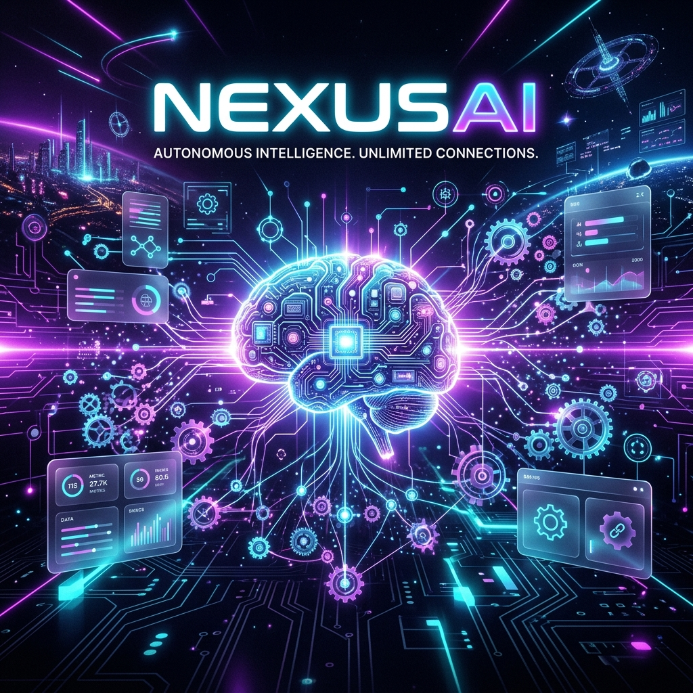

# NexusAI

The Ultimate Autonomous AI Agent Ecosystem.
Ready to use with just one command.



## Features
- **20+ LLM Providers**: OpenAI, Anthropic, Google Gemini, Groq, Mistral, Ollama, DeepSeek, TogetherAI, G4F (GPT4Free) and more!
- **7-Role Agent Pipeline**: Planner, Researcher, Tool Manager, Coder, Reviewer, Auditor, Verifier.
- **Multimodal & RAG**: Handles all formats (PDF, DOCX, Images, JSON) with an advanced retrieval pipeline.
- **Perplexity-like Web Search**: Built-in search bridge to synthesize information from the web.
- **2000+ Integrated Tools**: File ops, web scraping, git, databases, python execution, cryptography, math, email, Docker.
- **Web UI & Dashboard**: Stunning dark-mode dashboard to monitor and interact with your agents.
- **MCP Support**: Full Model Context Protocol server.
- **Plugin System**: Fully extensible via plugins.

## Installation

```bash
git clone https://github.com/shiva/nexusaicap.git
cd nexusaicap
pip install -e .[all]
```

## Quick Start

```bash
# Run an autonomous task
nexusai run "Build a weather dashboard in React"

# Start the interactive chat
nexusai chat

# Launch the Web Server
nexusai server
```

## Docker

```bash
docker-compose up -d
```


## Prerequisites
- Required environment and dependencies

